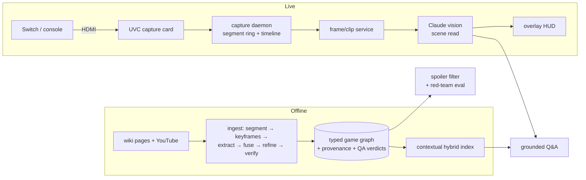

# game-coach

An AI coach for console games. It watches live gameplay from an HDMI capture card, builds a
knowledge base for any game from wiki text and YouTube video, and answers questions without
spoiling content the player hasn't reached yet. **Hollow Knight** was the first target game.

The project started as a *real-time* gameplay assistant. Measuring latency end to end showed that
real-time coaching on this hardware hits physical limits, so the product became a coach you
consult while the game is paused, plus an overlay that warns about hazards *before* you reach
them. The design analysis that led to that change is in [`docs/`](docs/).

**Stack:** TypeScript (Node), Python (NumPy/Pillow), ffmpeg/AVFoundation, Claude (Sonnet for
vision and answers, Haiku for classification and contextualization), Transformers.js embeddings,
yt-dlp.

---

## Highlights

- **Knowledge-base ingestion for any game.** Wiki pages and YouTube videos are segmented,
  keyframed, extracted into structured data with Claude vision, fused, refined and auto-verified
  into a typed game graph (zones, bosses, abilities, objectives, connectors and a progression
  lattice). Adding a game takes one `ingest/sources/<game>.json` file.
  - Hollow Knight: **480 nodes**. *Memories in Orbit*: **464 nodes**. The model had essentially no
    prior knowledge of *Memories in Orbit*, so that graph shows the pipeline learns a game from its
    sources rather than from pretraining.
- **Auto-QA instead of human review.** Each entity is grounded in the ingested corpus, then
  corroborated by counting distinct *publishers* rather than pages. Five pages from one
  contaminated wiki count as one source, and that rule is what exposed Silksong entities leaking
  into the Hollow Knight graph. An adversarial LLM panel then rules on every entity, and only
  low-confidence calls are escalated. The human review queue went from O(nodes) to O(escalations),
  and the last run had 0 escalations for both games (`kb/INGESTED_STATUS.md`).
- **Spoiler safety tested before it was built.** The red-team eval (`eval/`) was written before
  the game graph. It runs a fail-closed spoiler filter over every progression milestone, checks
  that every entity a coach names comes from the content the player has unlocked, and works as
  a build gate: the reference coach has 0 hard leaks, a deliberately leaky coach is caught on 9
  of 10 cases, and an unhelpful coach is flagged on 10 of 10. Grounding is the main check because
  the model already knows Hollow Knight from pretraining, so filtering retrieval alone isn't enough.
- **Hybrid RAG.** BM25 and embeddings are combined with reciprocal-rank fusion. Chunks are
  embedded with Anthropic-style *contextual retrieval*: an LLM writes a short context line for each
  chunk, cached by content. Answers are scored with a RAGAS-style LLM-judged eval (faithfulness,
  answer and context relevancy) plus a deterministic retrieval-hit check (`rag/`).
- **Capture daemon** (`src/`). An ffmpeg mpegts segment ring that survives crashes, a canonical
  timeline measured in capture-seconds, a frame and clip service, and honest capture-health
  reporting (it returns a reason instead of a black frame). Retention is
  **retain-until-analyzed**: media is deleted only after every consumer's watermark has passed it,
  never on a timer.
- **Live overlay** (`coach/`). Mirrors the captured frame and draws an arrow from the player to the
  on-screen target with a 1–4 word instruction ("jump right to ledge") and a hazard warning.
- **Weakly supervised perception data** (`perception/`, `training/`). A HUD reader for Hollow
  Knight counts the health masks shown on screen. Applied to a 62-hour YouTube corpus, it
  automatically labeled **37.7 hours of gameplay with 5,309 damage events**, as training data for
  an event-perception model. No human labeling.

## Architecture



## Design work

The code is backed by written design analysis:

| Doc | What it covers |
|---|---|
| [`docs/latency-teardown.md`](docs/latency-teardown.md) | Latency analysis of the real-time pipeline. Frames are already 40–210 ms old when the host receives them (capture card + USB delivery), and a reasoned tip costs about 1.6 s p50 / 3.9 s p95 even with cloud Claude. Reactive coaching under 300 ms is therefore infeasible for any reasoned tip. It also explains why cloud beats local on tail latency (shared SoC + thermals). |
| [`docs/design.md`](docs/design.md) | The full product and system design: 7 intent types defined by the kind of evidence each needs, a router, a per-intent frame-selection policy, contracts C1–C7, phasing and risks. |
| [`docs/spoiler-redteam-eval.md`](docs/spoiler-redteam-eval.md) | The spoiler eval spec: test strata, invariants, and why a grounding check comes before a filter. |
| [`docs/capture.md`](docs/capture.md) | Capture hardware (about $40 of UVC kit), setup, and the retention model. |

## Repo map

| Path | What |
|---|---|
| `src/` | Capture daemon: ffmpeg ring, timeline, frames, health, retention |
| `ingest/` | Multi-game ingestion: acquire → segment → keyframes → extract → fuse → refine → LLM sweep → verify |
| `kb/` | Game-graph schema, validator, and the built knowledge bases for two games |
| `rag/` | Contextual hybrid retrieval, grounded answers, LLM-judged eval |
| `eval/` | Spoiler red-team eval (fail-closed filter, grounding check, pluggable coaches) |
| `coach/` | `review` (Q&A at a pause) and `watch` (live overlay) |
| `perception/`, `training/` | HUD reader and weak-label pipeline for damage and death events |

## Running it

Requires Node 22+ and ffmpeg. Commands that call Claude need `ANTHROPIC_API_KEY` in `.env`.

```sh
npm install

# offline, no API key
npx tsx eval/run.ts --demo                                # spoiler eval: safe / leaky / useless coaches
npx tsx kb/validate.ts hollow-knight/graph.ingested.json  # structural check of the built KB

# capture (no hardware needed: test pattern or a local video file)
npx tsx src/cli.ts start --source=file:/path/to/gameplay.mp4

# coaching (capture running, API key set)
npm run guide -- review hollow-knight "how do I beat the Mantis Lords?" --sources
npm run guide -- watch hollow-knight --goal=map

# rebuild a knowledge base (extractions are cached)
npx tsx ingest/cli.ts ingest hollow-knight
```

## Status and known limitations

This is a research prototype, not a product. The open problems, stated plainly:

- **Not a live, turn-by-turn guide.** The capture buffer plus a vision round-trip take several
  seconds, and identifying the current zone from a single frame is unreliable. The dependable use
  is when the player *names* the problem ("how do I beat X", "what does this charm do").
- **The spoiler filter isn't connected to the live Q&A path yet.** It is built and enforced in
  the eval, but `rag/ask.ts` still relies on a prompt instruction. Connecting the two is the
  highest-value next step.
- **The progression lattice is provisional.** It approximates a linear walkthrough, and parts of
  the Hollow Knight order are wrong, which breaks "what's next" questions.
- **Some contamination remains.** The verifier removes most Silksong entities, but a few
  references are still in the Hollow Knight graph.
- **The perception labeler is a baseline.** HUD-based labels are noisy, especially for deaths, and
  no model has been trained on them yet.

Gameplay footage and raw scraped sources aren't included in this repo (they're gitignored); the
fetch scripts recreate them. Hollow Knight is © Team Cherry and *Memories in Orbit* belongs to its
developers. This project isn't affiliated with either.
